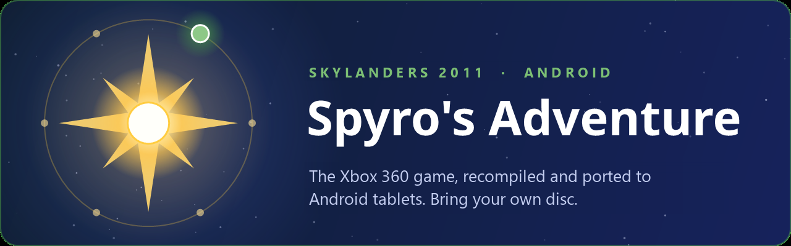

 

# SSARecomp for Android

**This is an Android port by [PixDel](https://github.com/PixDel) of [SSARecomp](https://github.com/tsapZ/SSARecomp),
which was developed by [tsapZ](https://github.com/tsapZ).** SSARecomp is the native Windows
recompilation of **Skylanders: Spyro's Adventure** (Xbox 360, 2011). The recompilation itself and
everything that makes the game run natively (the portal and portal menu, the settings menu, the
fixes) is tsapZ's work and that of the projects it builds on (see [Credits](#credits)). The
Android port is not by tsapZ: it adds what Android needs, namely an ARM64 build, a Vulkan driver
that draws the game right on Adreno GPUs, touch controls, a setup screen that installs the game
from your ISO, and tuning for tablet GPUs.

You bring your own copy of the game; nothing of it comes with this project.

> Unofficial fan project. Not affiliated with or endorsed by Activision or Toys for Bob. tsapZ
> doesn't maintain this port: please report problems of the Android version here, not there.

## How far it is: playable, not thoroughly tested

This port was made to **run**, and a lot of the work went into getting a steady frame rate on
**one device**. It has **not been tested in depth**: not every level, not other devices, not
every setting. Expect things that don't work yet. All tests and measurements were made on:

| | Test device |
|---|---|
| Device | **Honor MagicPad 2** (tablet) |
| Chip | **Qualcomm Snapdragon 8s Gen 3** |
| GPU | **Adreno 735** |
| Screen | 3000x1920 (12.3", 16:10) |
| System | Android 16 (MagicOS) |
| Graphics driver | Mesa Turnip T30 (bundled) |

Weaker devices will need a smaller 3D picture or won't reach 30 FPS; stronger ones may manage a
larger one.

**Please help:**

- Anything that doesn't work as it should: open an [issue](../../issues/new/choose) ("Problem").
  Every report helps, even a short one.
- **Tell me what your device reaches:** device and chip, the settings you used (3D picture size,
  driver, frame rate limit) and the FPS you get (Menu → Spiel → FPS-Anzeige shows them). Use the
  "Performance report" issue form. That is how this table grows past one device.

## Getting started

1. Download the APK from the [Releases](../../releases) page and install it.
2. Open it and choose your own **Xbox 360 ISO** of Spyro's Adventure (the region-free USA/Europe
   disc, [which one](https://github.com/tsapZ/SSARecomp#which-disc)). Its files (about 7.4 GB) are copied into
   the app once and the version is checked; then you can delete the ISO.
3. Tap **Spielen / Play**.

Long press on the app icon → **Spieldateien / Game files** opens the setup screen again (another
ISO, a graphics driver, `Lossless.dll`).

## What you need

- An Android device with a **Qualcomm Snapdragon (Adreno GPU)** and Android 11 or newer. Other GPUs
  (Mali, Xclipse, PowerVR) aren't supported yet.
- About 8 GB of free storage (the ISO's files), plus the ISO itself while installing.
- Tested only on an **Honor MagicPad 2 (Snapdragon 8s Gen 3, Adreno 735)**: a steady 30 FPS with
  the default 3D picture size (560x352).

## How it plays

- **Touch controls** on the screen, hidden while a controller is connected (Menu → Steuerung →
  Bildschirm-Steuerung: always, only the menu buttons, or off; opacity and size). The eye button
  hides them for a moment. The menus (settings, portal, player) work by touch too: tap a row, a
  tab, a figure, or a button hint at the bottom.
- **Controllers** work as on PC (the first one is player 1, a second one player 2).
- **Settings menu**: the touch Menu button, or Back+RB on a controller.

Frame rates measured on the Honor MagicPad 2 (Snapdragon 8s Gen 3, Adreno 735, Turnip T30, frame
rate limit 30, frame generation off), in the hub and the first chapter:

| 3D picture (Menu → Grafik → Größe des 3D-Bilds) | Honor MagicPad 2 |
|---|---|
| Leistung, 560x352 (default) | 30 FPS steady |
| Ausgewogen, 700x440 | about 28 FPS |
| Scharf, 840x528 | about 25 FPS |
| Original, 1120x704 (Xbox 360) | about 20 FPS |

Other devices: please send yours ([Performance report](../../issues/new/choose)).

## Graphics drivers

Qualcomm's own Vulkan driver draws the 3D scene wrong (one flat colour), so the app brings a
**Mesa Turnip** driver: **T30 by Mr. Purple** (PurpleVK, Mesa 26.3), the only one that draws
everything right in our tests. Menu → Grafik → **Grafiktreiber** picks it (*Mitgeliefert*, the
default), a driver you imported on the setup screen (*Eigener*, a `.so` or an emulator driver
`.zip` with `meta.json`), or the system's.

What we tried on the Snapdragon 8s Gen 3:

| Driver | Result |
|---|---|
| Turnip T30 (Mr. Purple, PurpleVK 26.3) | right, 30 FPS at 560x352: **bundled** |
| Qualcomm (system) | 3D scene one flat colour (4x MSAA depth reads as 0) |
| Turnip K11MCH1 v26 R8 | black 3D scene |
| Turnip Banner v27 | about every third frame wrong (flicker); right only with `flushall`, then slower than T30 |

If you try others, please say which device and driver in an issue.

## Frame generation (very experimental)

Menu → Grafik → **Frame Generation** puts a computed frame between every two real ones (Lossless
Scaling's frame generation through [lsfg-vk](https://github.com/PancakeTAS/lsfg-vk)). It needs
`Lossless.dll` from your own copy of [Lossless Scaling](https://store.steampowered.com/app/993090/)
(Steam), imported on the setup screen. It is barely tested: on displays fixed at 120 Hz the extra
frames aren't evenly spaced. Off by default.

## Not there yet

- **Cheats** (Menu → Extras) don't seem to work yet on Android.
- A real USB Portal of Power (the virtual portal menu works).
- GPUs other than Adreno.
- Online play.

## Building

See [docs/android.md](docs/android.md): Windows host tools, NDK r30, the native build, packaging
and signing. The Windows version is documented in
[tsapZ's README](https://github.com/tsapZ/SSARecomp#readme).

## How it was made

Like SSARecomp itself, almost all of the code was written with Claude (Anthropic), tested on the
device above.

## Credits

- **[SSARecomp](https://github.com/tsapZ/SSARecomp)** by **tsapZ**: the game's recompilation and
  everything that makes it a native game; this repository is a fork of it. Also by tsapZ:
  [Core of Light](https://github.com/tsapZ/SkylandersCoreOfLight) and the other Skylanders
  recompilations ([Giants](https://github.com/tsapZ/GiantsRecomp),
  [Swap Force](https://github.com/tsapZ/SwapForceRecomp), ...).
- **[GiantsRecomp](https://github.com/TheBiemGamer/GiantsRecomp)** and
  **[skylanders-portal](https://github.com/TheBiemGamer/skylanders-portal)** by TheBiemGamer: the
  template these projects started from, and the portal.
- **[ReXGlue](https://github.com/rexglue/rexglue-sdk)**, the static recompilation SDK, rooted in
  [Xenia](https://github.com/xenia-project).
- **Mesa Turnip** ([Mesa](https://mesa3d.org), MIT), the T30 build by **Mr_Purple_666**, loaded
  with **[libadrenotools](https://github.com/bylaws/libadrenotools)** by bylaws.
- **[lsfg-vk](https://github.com/PancakeTAS/lsfg-vk)** by PancakeTAS (in
  [GameNative's Android build](https://github.com/GameNative/lsfg-vk-android)) for frame
  generation; Lossless Scaling by THS is not included.
- **[SDL](https://libsdl.org)**, AMD **FidelityFX** FSR 1 / CAS, DXVK's DXBC translator,
  [pe-parse](https://github.com/trailofbits/pe-parse).
- **[extract-xiso](https://github.com/XboxDev/extract-xiso)**, whose disc layout the setup
  screen's ISO reader follows.

Skylanders is a trademark of Activision. This project is not affiliated with or endorsed by
Activision.

## License

The code and documentation in this repository are released under the [MIT license](LICENSE). That
doesn't cover the game or its data, which you need to own and supply yourself, or the third-party
components in `thirdparty/` and the bundled driver, which keep their own licenses; the app lists
them on its setup screen ([THIRD_PARTY_NOTICES.md](android/app/src/main/assets/THIRD_PARTY_NOTICES.md)).
